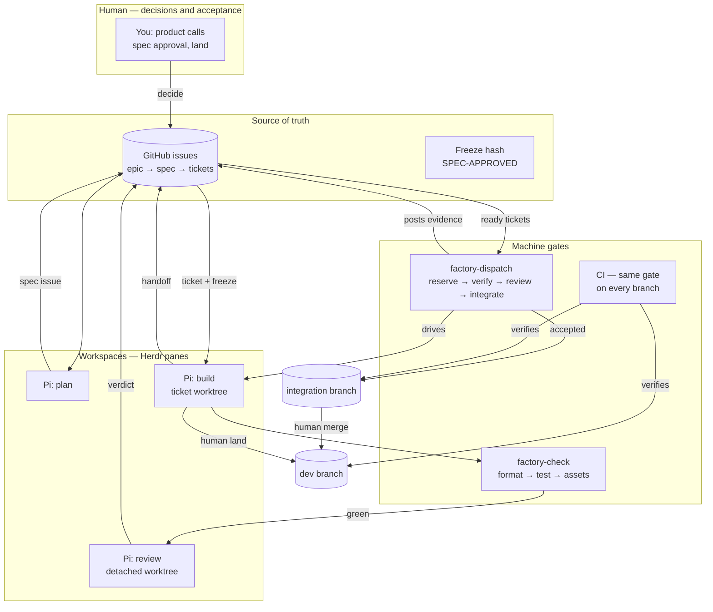
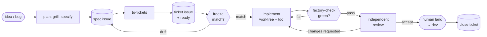
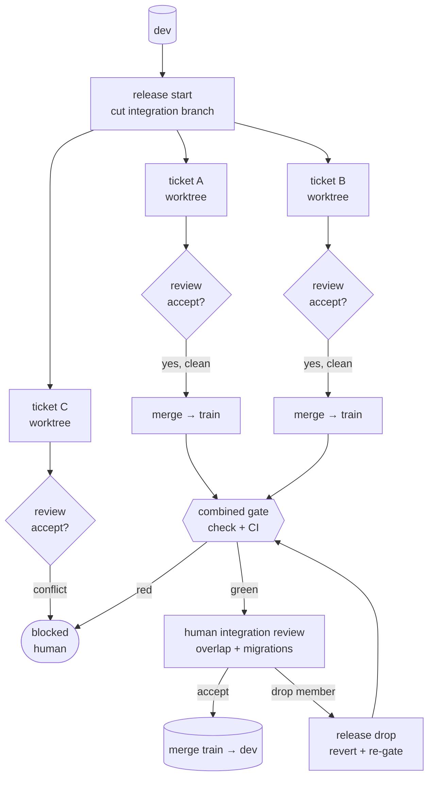

# pi-factory usage guide

The factory turns GitHub issues into landed changes with Pi doing the
engineering, Herdr holding the workspaces, and machines enforcing the gates.
You supply product decisions and approve risky changes. Start here; advanced
detail lives in `docs/WORKFLOW.md` (the loop) and `docs/DISPATCHER.md` (L3 ops).

## Install

New or existing project, one line (idempotent, never overwrites):

```bash
cd /path/to/project
curl -fsSL https://raw.githubusercontent.com/mrdankuta/pi-factory/main/install.sh | bash -s -- --stack elixir
# --stack elixir|node|python   --pin vX.Y.Z   --global-skills
```

This installs: `.pi/prompts/` (plan/build/review/handoff), `.agents/skills/`
(8 vendored skills, no global dependency), `scripts/factory` +
`scripts/factory-dispatch` (the CLIs), `scripts/factory-check` (the gate),
the factory header in `AGENTS.md`, `GLOSSARY.md`, `docs/` skeleton,
`.github/ISSUE_TEMPLATE/` (spec/ticket) + factory labels. It checks for `gh`
and `herdr` and tells you what to do if either is missing
(`herdr integration install pi` for Herdr).

## Concepts (five minutes)

- **Issues are the authority.** Epic → spec issue → ticket issues. There are
  no committed spec/ticket/review `.md` files; `factory/.cache/` holds
  gitignored snapshots only (`factory sync` regenerates them).
- **Freeze = approval.** `factory freeze <spec>` records a `SPEC-APPROVED
  <hash>` comment. Any later body edit invalidates the hash; review is
  blocked until re-freeze. `factory verify-freeze` checks mechanically.
- **Labels are the state machine.**
  `ticket` + `ready` → `running` → `review` → `accepted` → closed (landed).
  `blocked` parks anything needing a human. `spec` / `spec-approved` mark specs.
- **Humans own `accepted` → land.** No automation lands, merges to dev, or
  pushes. Ever. (The dispatcher enforces this by construction — it has no
  land code path.)
- **Evidence, not claims.** Handoffs and reviews are issue comments with
  commands + actual output. "Done" is an event; verified criteria are the outcome.

## How the parts fit



- **Issues** hold every decision and state change; nothing authoritative lives in local files.
- **Herdr panes** hold the agents; **files + commits + issue comments** are the handoffs between them.
- **Gates** (check, CI, freeze, review) decide mechanically; **humans** decide acceptance and landing.
- The **dispatcher** never creates authority — it only moves tickets along the rails above, up to (never including) `dev`.

## The daily loop

End to end, one ticket:



### 1. Plan (`/plan` — no implementation)

In a planning session, grill then specify. Output is a **spec issue**
(template `spec`): problem, users/permissions, behaviour, domain rules,
acceptance criteria, non-goals, design, verification, release, open
decisions. Do not move past open consequential decisions.

### 2. Slice into tickets

One issue per ticket (template `ticket`): parent spec, `Depends on:`,
risk, copied acceptance criteria, scope, out of scope. Tracer bullet first —
one complete vertical path before parallel expansion. Add `ready` when a
ticket may run.

### 3. Freeze the spec

```bash
scripts/factory freeze 42        # posts SPEC-APPROVED hash + labels spec-approved
scripts/factory verify-freeze 42 # re-check any time (exit 1 on drift)
scripts/factory sync 42          # local cache for offline reading
```

### 4. Work a ticket — two modes

**Manual (L0–L2):** `scripts/factory start 42 [--pane <herdr-pane>]`
creates worktree `../<repo>-T42`, branch `factory/T42-<slug>`, and the
implementer brief (build prompt + ticket body). With `--pane` it also opens
the Herdr pane and launches the agent; without, it prints the commands.
Implementer rules live in `.pi/prompts/build.md`: only this ticket's scope,
tdd, tests for the criteria, `scripts/factory-check`, handoff via
`scripts/factory handoff 42 --signal READY_FOR_REVIEW|NEEDS_CLARIFICATION|BLOCKED`.

**Dispatcher (L3):** `./scripts/factory-dispatch once --dry-run` shows what
would happen (no spend, no mutations). Then:

```bash
./scripts/factory-dispatch once            # one pass (cron-safe)
./scripts/factory-dispatch daemon --interval 300 &   # or cron/systemd `once`
./scripts/factory-dispatch status          # attempts + worktrees
./scripts/factory-dispatch stop            # human stop; resume to continue
```

One pass per ticket: reserve (sqlite, duplicate-safe) → spec freeze check →
`pi -p` implement (timeout) → `factory-check` gate → commit (empty commit
with handoff summary when side-effect-only) → detached review worktree +
`pi -p` reviewer → report posted **by the dispatcher**, `VERDICT:` parsed →
`accepted` (awaiting your land) or back to `ready`. Bounded retries, then
`blocked` with a human-readable reason. Knobs: `MAX_CONCURRENT=3`,
`MAX_ATTEMPTS=2`, `TIMEOUT_IMPL=1800`, `TIMEOUT_REVIEW=1200`, `PI_BIN`,
`PI_MODEL`.

### 5. Review (`/review` — never in-session, never your own diff)

Fixed `BASE..HEAD`, immutable detached worktree, separate Pi process in a
Herdr pane. Two passes: spec compliance (`[spec-drift]`,
`[tenant-violation]`, `[authz-gap]`, `[weak-test]`) and standards/risk
(`[complexity]`, `[secret-leak]`, migrations, shared-asset sweep). Report
goes on the ticket issue; single round by default — fixes get one pass,
noted unverified, human judges at land.

### 6. Land (human)

Your project's land skill (e.g. `.agents/skills/land/`): preflight (scope,
secrets), gate (`mix precommit` / `factory-check`), linear commit onto dev,
plain push, confirm on `origin/dev`. Then close the ticket issue.

### 7. Release trains (batching tickets)

Instead of landing tickets one by one, fan them out from an integration
branch and merge the train once:



- One open train at a time; ticket worktrees base on the train head.
- Accept-path auto-merge is clean-only — conflicts route to `blocked`, never forced.
- `release drop` reverts a member; closing the train (mark merged, clean up
  branches) is a human step after merging to `dev`.
- Your train→dev review uses `prompts/review-integration.md`: combined gate, overlap scan, migration order, drift check.

## Workspace layout (Herdr)

```
Planning / integration  — pi (owns specs, tickets, land)
Implementation          — pi in ticket worktree (one branch per ticket)
Verification            — tests, server, logs, factory-check output
Review (on demand)      — fresh pi, detached-HEAD worktree, read-only
```

Unique `pi --session-id` per ticket+role (`impl-T42-<date>`,
`review-T42-<date>`). One worktree + one branch per ticket. Worktrees isolate
files, not shells/secrets — keep production credentials out.

## Concurrency

The dispatcher runs up to `MAX_CONCURRENT=3` attempts at once (env knob).
Each attempt holds a `FACTORY_SLOT` (1..3) exported to the implementer and
the check step — stacks isolate per slot (separate test DBs, ports,
tmpdirs). Claims are atomic, so overlapping scheduled and manual passes
can't double-book. Dial down to `MAX_CONCURRENT=1` until a new stack
proves slot isolation. See `docs/DISPATCHER.md`.

## Stacks and languages

Elixir, node, and python ship with check adapters (`checks/`) and CI
templates (`github/workflows/`). Adding one (go, rust, …) is three steps:
write `checks/factory-check-<name>` honoring the gate contract
(format → lint → test, non-zero on fail, `FACTORY_SLOT` isolation), register
it in `factory`'s `--stack` handling, and copy a CI template that runs the
same `./scripts/factory-check` developers run. Full contract in `README.md`
("Adding a language stack"). Prompts, skills, dispatcher, and freeze
mechanics never change per stack.

## Metrics and improvement

```bash
scripts/factory metrics --limit 20   # open buckets + closed cycle times
scripts/factory reconcile             # open issues vs origin/dev drift
```

Track: ready→accepted time, review rejection rate, rework per ticket,
escaped defects, blocked time, cost per accepted change. Feed the biggest
friction into `/retro` — proposals, not auto-applied changes.

## Troubleshooting

| Symptom | Cause → fix |
|---|---|
| `freeze MISMATCH` | Spec body edited after approval → review the edit, `factory freeze` again |
| `DISPATCH: no changes` | True noop (implementer did nothing) → check its log in `factory/.state/logs/` |
| Ticket `blocked` after retries | Attempt budget exhausted → read comments, decide manually, unblock |
| Reviewer reports nothing | Review log kept in state dir; brief requires `VERDICT:` last line |
| CI red on a branch | Same `scripts/factory-check` you run locally — fix, don't weaken |
| `init` says templates missing | Project shim can't seed alone → run `install.sh` (it fetches pi-factory) |

## Command reference

`factory init|update|freeze|sync|handoff --signal|reconcile|check|verify-freeze|metrics|start [--pane]|version`
`factory-dispatch once [--dry-run]|daemon [--interval]|status|stop|resume|release {start|status|merge|drop}|self-test`
